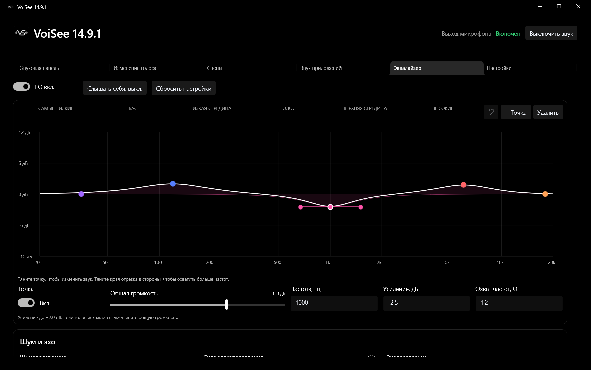
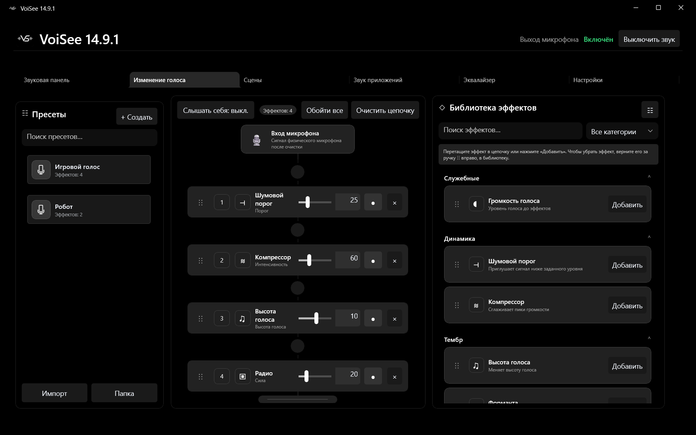
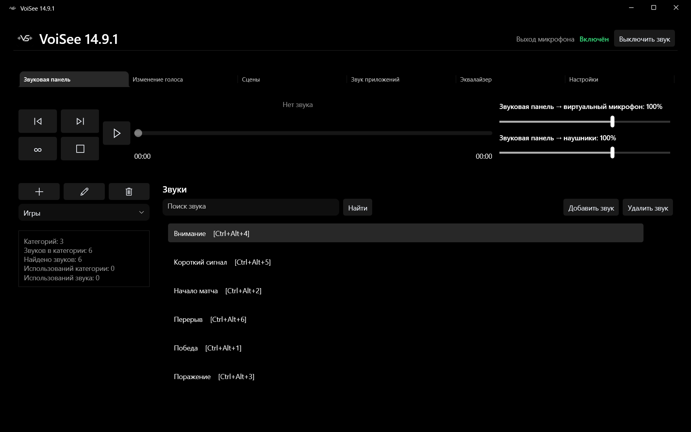
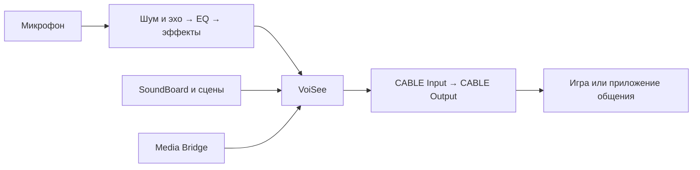

<div align="center">


# VoiSee

**Голос, звуки и музыка — в одном виртуальном микрофоне.**

Обработка микрофона, изменение голоса, SoundBoard и звук приложений для игр и общения на Windows.


### [Скачать для Windows x64](https://github.com/VoriX0/VoiSee/releases/latest)

[Все версии](https://github.com/VoriX0/VoiSee/releases) · [Возможности](#возможности) · [Быстрый старт](#быстрый-старт) · [Сборка](#сборка-из-исходников) · [Сообщить о проблеме](https://github.com/VoriX0/VoiSee/issues)

</div>

---

## Как выглядит VoiSee

Интерактивный эквалайзер: меняйте звучание прямо на графике и настраивайте шум и эхо рядом с ним.

[](docs/images/equalizer.png)

<table>
<tr>
<td width="50%" align="center"><strong>Изменение голоса</strong><br/><a href="docs/images/voice-changer.png"></a></td>
<td width="50%" align="center"><strong>Звуковая панель</strong><br/><a href="docs/images/soundboard.png"></a></td>
</tr>
</table>

*Скриншоты сделаны в VoiSee с демонстрационным профилем. Категории, звуки и пресеты создаёт пользователь.*

## Возможности

| Раздел | Что можно сделать |
|---|---|
| **Эквалайзер** | Настроить голос на частотном графике, добавить свои точки, изменить частоту, усиление и ширину фильтра. |
| **Шум и эхо** | Выбрать RNNoise или DeepFilterNet, отрегулировать силу шумоподавления и включить эхоподавление. |
| **Изменение голоса** | Собрать цепочку из 34 эффектов, менять их порядок, отключать отдельные карточки и сохранять пресеты. |
| **Звуковая панель** | Импортировать WAV, MP3 и OGG, распределять звуки по категориям и запускать их горячими клавишами. |
| **Редактор звуков** | Выделять фрагменты на волне, обрезать, вырезать, менять громкость, нормализовать и добавлять плавное начало и окончание. |
| **Сцены** | Объединить голос, звуковые кнопки и фон в один сохраняемый сценарий. |
| **Звук приложений** | Передать звук выбранного приложения в виртуальный микрофон через Media Bridge. |
| **Настройки** | Выбрать микрофон и наушники, настроить автозапуск, язык, горячие клавиши и собственную тему оформления. |

### Эквалайзер и очистка микрофона

- **Управление мышью:** тяните центральную точку по частоте и усилению, боковые точки — чтобы изменить ширину фильтра.
- **Свои фильтры:** добавляйте и удаляйте точки; задавайте параметры числами. Доступны пиковый фильтр, низкая и высокая полки, срез низких и высоких частот.
- **Два способа настройки:** интерактивная кривая и графические полосы — 10 в обычном режиме, 31 в расширенном.
- **Отмена действий:** кнопка возврата и `Ctrl+Z` отменяют изменения эквалайзера.
- **Громкость и мониторинг:** регулируйте предусиление и отдельно включайте прослушивание собственного голоса.
- **Общий профиль:** коррекция сохраняется для пользователя при смене микрофона. Пресеты и сцены не перезаписывают её.
- **Шумоподавление:** RNNoise и DeepFilterNet обрабатывают микрофон; SoundBoard и Media Bridge проходят отдельно. DeepFilterNet требует больше ресурсов, чем RNNoise.
- **Эхоподавление:** один переключатель для подавления звука колонок и ослабления комнатных отражений. Обработка выполняется на CPU, без обязательной NVIDIA RTX. Опорный звук берётся с устройства воспроизведения Windows.

### Изменение голоса

В центре — цепочка обработки, справа — библиотека эффектов, слева — пресеты. Карточки можно переставлять, отключать и удалять кнопкой или перетаскиванием обратно в библиотеку.

Пресеты сохраняют порядок, значения и отключённые эффекты. Их можно переименовать, назначить им иконки и горячие клавиши, импортировать и экспортировать в JSON. **Push-to-Talk пресета** применяет голос на время удержания клавиши и возвращает прежнюю цепочку после отпускания.

<details>
<summary><strong>Все 34 эффекта</strong></summary>

| Группа | Эффекты |
|---|---|
| Уровень и динамика | Усиление голоса, шумовой порог, компрессор |
| Тон | Высота голоса, форманты, низкие и высокие частоты |
| Пространство и модуляция | Эхо, реверберация, тремоло, хорус, флэнжер, фэйзер, вибрато, удвоение |
| Характер голоса | Искажение, робот, радио, биткрашер, пришелец, кольцевая модуляция, бурундук, гигант, призрак, заикание, колебание, мужской и женский тембр, одержимый, мегафон, вертолёт, киборг, сломанное радио, вокодер |

</details>

### SoundBoard и редактор

Импортируйте файлы кнопкой или перетащите их из Проводника. Для звуков доступны категории, поиск, сортировка, переименование, перемещение и копирование между категориями, открытие файла в Проводнике и назначение горячих клавиш.

У звуков раздельные громкости **в виртуальный микрофон** и **в наушники**. Можно включить повтор, поставить воспроизведение на паузу, перемотать или перейти к соседнему треку. Дополнительная задержка SoundBoard применяется к его виртуальному выходу, отдельно от голоса.

Встроенный редактор открывается из контекстного меню трека:

- выделение фрагмента непосредственно на звуковой волне;
- обрезка всего за пределами выделения или вырезание выделенного участка;
- усиление, нормализация, fade in / fade out и искажение;
- прослушивание через наушники без отправки превью в виртуальный микрофон;
- сохранение в текущий трек или создание отдельной редактированной копии.

Длинные звуки воспроизводятся потоком. Для редактирования действует ограничение полного декодирования в память: слишком большой файл не загружается целиком без ограничений.

### Сцены

Сцена хранит снимок голосовой цепочки, звуковые кнопки, громкости, горячие клавиши и выбранный фон. Сохранённое звучание не зависит от последующего переименования, изменения или удаления исходного пресета.

Фоном может быть зацикленный файл или профиль Media Bridge. Для кнопок сцены доступны собственные названия, горячие клавиши и громкости. Сцену можно активировать, отключить и отдельно управлять её звуками; после отключения восстанавливается предыдущая голосовая цепочка.

### Media Bridge — звук приложений

Выберите окно приложения, посмотрите превью и передайте его звук в виртуальный микрофон. Доступны запуск, пауза, продолжение, остановка, отдельная громкость, индикаторы уровня и горячая клавиша паузы.

Профили источников можно использовать в сценах. Для Яндекс Музыки, Spotify и YouTube предусмотрены сценарии запуска приложения или браузера.

Выбранное окно определяет **процесс-источник**: захватывается звук процесса, а не гарантированно одной вкладки браузера. Media Bridge не добавляет вторую копию звука в наушники и не возобновляет захват автоматически после перезапуска VoiSee.

### Работа в фоне и оформление

- Закрытие окна сворачивает VoiSee в трей; звук и горячие клавиши продолжают работать. Для завершения выберите **«Выйти»** в меню трея.
- Повторный запуск открывает существующее окно вместо создания второго аудиодвижка.
- Автозапуск Windows открывает приложение в трее. Запуск другой копии программы не переписывает существующую регистрацию автозагрузки.
- Списки устройств обновляются по уведомлениям Windows и кнопкой Refresh. После сна восстановление допускается только для прежнего доступного маршрута.
- Мониторинг голоса и прослушивание SoundBoard независимы. Отключение виртуального выхода не отключает прослушивание в наушниках.
- Есть защита от повторного попадания обработанного голоса в звук трансляции Discord через обычный VB-CABLE.
- Русский и английский интерфейс; смена языка применяется после полного перезапуска.
- Пользовательские темы `*.voiseetheme.xaml`, создание шаблона, импорт, экспорт и применение изменений после сохранения файла. Примеры — в [sample-themes](sample-themes).

## Быстрый старт

1. Скачайте установщик `.exe` из [последнего релиза](https://github.com/VoriX0/VoiSee/releases/latest). Файл `SHA256SUMS.txt` рядом с ним содержит контрольную сумму.
2. Установите VoiSee и виртуальный кабель **VB-CABLE**, если он ещё не установлен. Комплект драйвера включён в установщик; его установка — отдельный дополнительный шаг.
3. В настройках VoiSee выберите физический микрофон и устройство прослушивания. Виртуальный выход VB-CABLE определяется автоматически.
4. В Discord, игре или другом приложении общения выберите вход **CABLE Output (VB-Audio Virtual Cable)**.
5. Настройте эквалайзер, очистку и эффекты. Кнопку **«Слышать себя»** включайте, когда нужен мониторинг голоса.



**CABLE Input** — устройство, в которое VoiSee отправляет звук. **CABLE Output** — виртуальный микрофон, который выбирается в приложении общения.

## Требования и данные

**Windows x64, Windows 10 версии 2004 или новее / Windows 11.** Для захвата звука процессов в Media Bridge нужна Windows со сборкой **20348 или новее**; обычная Windows 10 22H2 ниже этого порога. Для Media Bridge используйте Windows 11.

Установщик включает .NET и WinUI: отдельно устанавливать их для запуска этой поставки не требуется. Для передачи микса в другие приложения используется [VB-CABLE](https://vb-audio.com/Cable/).

Настройки и библиотека хранятся в `%LOCALAPPDATA%\VoiSe`: звуки, отредактированные файлы, пресеты, сцены и темы. При обычном удалении приложения пользовательские данные сохраняются. Для резервной копии полностью завершите VoiSee через трей и скопируйте эту папку.

Память кеша и фоновые загрузки ограничиваются автоматически. При ошибке записи приложение показывает несохранённые изменения и позволяет повторить сохранение. Потребление ресурсов и задержка зависят от устройства, драйвера и включённых обработчиков; одинаковые цифры для всех ПК не обещаются.

## Сборка из исходников

Нужны Windows, .NET SDK из [global.json](global.json) и компоненты сборки Windows/WinUI. Для установщика дополнительно нужен **Inno Setup 6**.

```powershell
git clone https://github.com/VoriX0/VoiSee.git
cd VoiSee
dotnet run --project .\src\VoiSe.App\VoiSe.App.csproj -c Release
```

Сборка установщика:

```powershell
.\scripts\build-installer.ps1
```

Результат: `artifacts\installer\<версия>\VoiSee-Setup-<версия>-x64.exe` и `SHA256SUMS.txt`. Для повторной сборки той же версии добавьте `-Force`; для ZIP-поставки — `-Portable`. Сборки и пользовательские данные не добавляются в Git.

Первой сборке нужен доступ к NuGet и загрузке нативного DeepFilterNet. Установщик после сборки содержит эти компоненты.

<details>
<summary><strong>Архитектура и проверки для разработчиков</strong></summary>

| Модуль | Ответственность |
|---|---|
| `VoiSe.Core` | Общая атомарная запись без зависимостей от UI и аудиодрайверов |
| `VoiSe.Audio` | WASAPI, DSP, каталог эффектов, транспорт звуков, потоковое чтение, ограниченные кеши и уведомления устройств |
| `VoiSe.App` | WinUI, контроллер аудиосессии, состояние цепочки, снимки сцен, хранение, отмена фоновых задач и интеграция с Windows |

Регрессионные проверки:

```powershell
dotnet run --project .\tests\VoiSe.RegressionTests -c Release
```

Профиль компонентов и десятиминутная нагрузочная проверка:

```powershell
dotnet run --project .\tests\VoiSe.PerformanceTests -c Release -- --seconds 10 --soak-minutes 10
```

Продолжительность задаётся `--soak-minutes` — до 480 минут. Отчёт JSON сохраняется в `artifacts\performance`. Стенд использует синтетическое аудио и не открывает микрофон, выходы Windows или приложения общения. Его результаты не заменяют замер полной программы с устройствами и проверку задержки до собеседника.

На физических устройствах отдельно проверяются отключение USB/Bluetooth, сон и пробуждение, смена устройств, длительная работа с игрой и сквозная задержка. Не считать успешную сборку подтверждением этих сценариев.

Сторонние лицензии и сведения об аудиообработчиках — в [ThirdPartyLicenses](src/VoiSe.App/ThirdPartyLicenses).

</details>

---

**Разработка:** [VoriX0](https://github.com/VoriX0) · **Новости:** [VoriXdev в Telegram](https://t.me/VoriXdev) · **Ошибки и предложения:** [GitHub Issues](https://github.com/VoriX0/VoiSee/issues)
